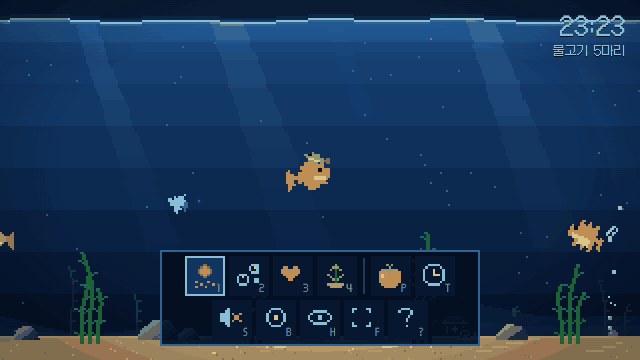
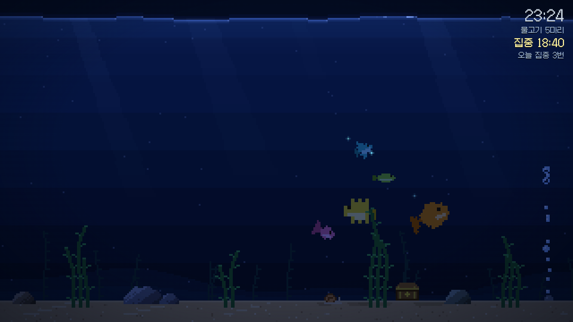

# 픽셀 아쿠아리움

공부할 때 켜 두는 픽셀 아트 수조. 물고기를 키우면서 뽀모도로 타이머로 집중해요.

**[▶ 바로 열어 보기](https://shinhchn.github.io/pixel-aquarium/)** · 설치 없이 브라우저에서 바로 돌아가요

## 기능

- **물고기 5종**: 금붕어 · 네온 · 엔젤 · 복어 · 베타. 물고기마다 겁 · 식탐 · 활력 성향이 있고, 먹이를 주거나 쓰다듬거나 커서를 휘젓는 방식에 따라 성격이 바뀌어요
- **번식과 수명**: 배부른 물고기끼리 짝을 지어 알을 낳고, 아기는 부모의 색과 성향을 닮아요. 수명이 다하면 떠나서 수조가 꽉 차지 않아요
- **집중 타이머 (뽀모도로)**: 집중하는 동안엔 수조만 보이고, 끝나면 알림음과 함께 물고기들이 반겨 줘요. 오늘 집중한 횟수를 기록해요
- **낮 · 노을 · 밤**: 자동으로 두면 오늘 해돋이 · 해넘이 시각에 맞춰 바뀌어요
- **소리**: 물소리와 음악 크기를 따로 조절해요
- 호흡 안내, 수초 심기, 이름 짓기, 바라보기 모드, 모바일 터치

## 기술적으로 고민한 점

| 문제 | 해결 |
|---|---|
| 캔버스로 돌리면 도트가 비스듬히 뭉개진다 | `ctx.rotate` 대신 화면 픽셀마다 역회전해서 원래 도트 맵의 칸을 찾아 그린다 (`drawFish`) |
| 물고기가 일정한 속도로 좌우만 오가서 기계 같다 | 순항 · 두리번 · 쏜살같이를 오가는 '헤엄 리듬'과 꼬리 차기를 넣었다. 속도 변동계수 0.11–0.19 → 0.47–0.60 (헤드리스 브라우저로 측정) |
| 소리 파일을 넣으면 용량과 라이선스가 부담된다 | 물소리(갈색 소음), 5음계 오르골 음악, 효과음을 모두 Web Audio로 합성. 소리 파일 0개 |
| 탭을 내려 두면 `requestAnimationFrame`이 멈춰서 타이머가 늦어진다 | 프레임마다 더하지 않고 실제 끝나는 시각을 기준으로 재고, 끝나는 순간은 별도 타이머로 잡는다. 새로고침해도 이어진다 |
| 해 뜨는 시각을 알려면 위치 권한이 필요하다 | 날짜로 태양 적위와 균시차를 계산해 어림한다. 서울 기준 하지 · 동지 실제 시각과 1분 안팎 |
| 저장 형식을 바꾸면 기존 사용자의 수조가 날아간다 | `localStorage` 형식을 바꿀 때마다 예전 데이터를 새 형식으로 옮기는 코드를 같이 넣었다 |

**의존성 0**: 빌드 도구나 프레임워크 없이 `index.html` 파일 하나(약 4,000줄)에 HTML · CSS · JS가 모두 들어 있어요. 외부 리소스는 폰트(Galmuri) 하나뿐이에요.

## 실행

`index.html`을 브라우저로 열면 돼요.

## 작업 방식

AI 코딩 에이전트(Claude Code)와 함께 만들었어요.

- [`AGENTS.md`](AGENTS.md)에 에이전트가 지킬 규칙을 정해 뒀어요: 단일 파일 유지, 저장 데이터 보존(마이그레이션), 모바일 터치 확인, 기능 하나 = 커밋 하나
- [`TASKS.md`](TASKS.md)의 작업 하나를 git 워크트리 하나로 나눠 진행했어요
- 변경할 때마다 헤드리스 Chrome으로 콘솔 에러, 390px 모바일 화면, 저장 데이터 마이그레이션을 확인했어요
